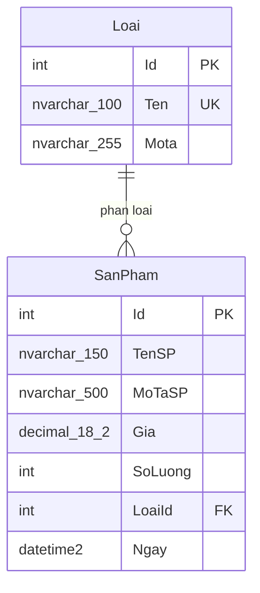

# ERD - QLSanphamDB

Ràng buộc:

- `Loai.Ten` là duy nhất.
- Cặp `SanPham(LoaiId, TenSP)` là duy nhất.
- `SanPham.LoaiId` tham chiếu `Loai.Id`; không xóa loại nếu còn sản phẩm.
- `SanPham.Gia > 0`.
- `SanPham.SoLuong >= 0`.
- `SanPham.Ngay` mặc định dùng UTC từ SQL Server.
